<h1 align="center">QR Attendance</h1>

<p align="center">
  Strict-chain QR attendance for e-learning sites.<br>
  One scan, one record, then the QR changes.
</p>

<p align="center">
  
  
  
  
</p>

<p align="center">
  
</p>

## Why it exists

Paper registers get signed for absent friends. A QR code that never changes can be screenshotted and shared with someone who isn't in the room.

QR Attendance fixes both: every code works for **one student only**, expires after **15 seconds**, and is replaced the moment it is used.

## Features

- **One-time codes:** a fresh QR after every successful scan, so screenshots are useless
- **Live lecturer screen:** names appear instantly over a WebSocket
- **In-page phone scanner:** opens the camera inside the page (built-in QR reader with a jsQR fallback)
- **Works like an assignment:** the lecturer sets open and close times, and the server enforces them
- **Fair records:** one record per student, and one phone can't mark two people
- **CSV export** of every session
- **Built to plug into Moodle** as an LTI tool (planned, see the roadmap)

## How it works

1. The lecturer opens an attendance activity and the screen shows QR #1.
2. A student scans it, in the page's camera or with the phone's camera app.
3. The server checks the code: real, unused, under 15 seconds old, attendance open, student not already present, phone not used by someone else.
4. The server claims the code in one atomic database step, so two simultaneous scans can't both win, and records the student.
5. The server issues QR #2 and pushes it, with the student's name, to the lecturer's screen.

```text
 Lecturer screen            Server (Rust)                 Student phone
 ───────────────            ─────────────                 ─────────────
 shows QR #1   ◄─WebSocket─ issues code #1
                                  ▲
                                  │  POST /api/attend
                                  └──────────────────────  scans QR #1
 name appears  ◄─WebSocket─ records student, issues #2
 shows QR #2
```

## Quick start

You need [Rust](https://rustup.rs). Then:

```bash
git clone https://github.com/User219-219/qr-attendance.git
cd qr-attendance
MOCK_LTI=1 cargo run
```

On Windows PowerShell use `$env:MOCK_LTI="1"` on one line, then `cargo run` on the next.

Open <http://localhost:3000>, sign in as a lecturer with the dev launcher, and create an activity. Sign in as a student in a second browser profile and scan the QR on the lecturer's screen.

Run the tests with `cargo test`.

### Testing on a phone

Phone browsers only allow the camera on **HTTPS**. Use a tunnel such as cloudflared and tell the server its public address:

```bash
cloudflared tunnel --url http://localhost:3000
BASE_URL="https://your-tunnel-address" MOCK_LTI=1 cargo run
```

### Settings

| Variable | Default | Meaning |
|---|---|---|
| `MOCK_LTI` | off | Set to `1` to enable the developer-only fake login at `/mock/launch` |
| `SECRET` | dev value if `MOCK_LTI=1` | 16+ random characters that sign session cookies |
| `BASE_URL` | `http://localhost:PORT` | Public address. It is encoded in every QR, so it must match what students open |
| `PORT` | `3000` | Port to listen on |
| `BIND` | `127.0.0.1` | Address to listen on. `0.0.0.0` lets other devices on the same network connect |
| `DATABASE_URL` | `sqlite://attendance.db` | SQLite file |

## Project layout

```text
qr-attendance/
├─ Cargo.toml
├─ migrations/0001_init.sql   database tables
├─ src/
│  ├─ main.rs      server start and the 1-second QR rotation timer
│  ├─ routes.rs    web addresses and the scan logic
│  ├─ tokens.rs    one-time codes
│  ├─ auth.rs      signed login cookie
│  ├─ qr.rs        QR image
│  └─ state.rs     live screens and current codes
├─ static/         browser pages
└─ docs/           demo animation
```

## API

| Method | Path | Who | What it does |
|---|---|---|---|
| `POST` | `/api/activities` | lecturer | Create an activity with open and close times |
| `POST` | `/api/activities/:id/close` | lecturer | Close attendance early |
| `GET` | `/api/activities/:id/attendance` | lecturer | List who is present (JSON) |
| `GET` | `/api/activities/:id/attendance.csv` | lecturer | Export the list as CSV |
| `GET` | `/api/activities/:id/info` | anyone signed in | Title and whether it is open |
| `POST` | `/api/attend` | student | Submit a scanned code |
| `GET` | `/ws/:id` | lecturer | WebSocket that pushes new QRs and names |

## Security notes

- Codes are 128-bit random and stored only as SHA-256 hashes
- Claiming a code is a single atomic `UPDATE ... WHERE used_at IS NULL`
- Codes last 15 seconds, with a 3 second grace period for network lag
- Database constraints stop duplicate students and one phone marking several people
- The server enforces the open and close times, never the browser's clock
- Sessions are HMAC-signed cookies, and the developer login only exists when `MOCK_LTI=1`
- CSV export neutralises spreadsheet formulas

## Roadmap

- [x] One-time code chain
- [x] Live lecturer screen over WebSocket
- [x] In-page camera scanner
- [x] CSV export
- [ ] Real Moodle login using LTI 1.3
- [ ] Rate limiting per IP
- [ ] Cleanup of old codes
- [ ] Send attendance back to the Moodle gradebook

## Status

A working prototype. The fake developer login stands in for Moodle until the LTI connection is built.

## Author

Built by [User219-219](https://github.com/User219-219), a computer science student.

## License

MIT. See [LICENSE](LICENSE).
